# Molecular Dynamics

[](https://github.com/nhantran1711/molecular-dynamics/actions/workflows/ci.yml)

A molecular dynamics engine in C++20 that simulates a Lennard-Jones fluid with Velocity Verlet integration and periodic boundary conditions. Cell lists and Verlet neighbour lists make each step O(N) instead of O(N²), and OpenMP spreads the step across cores. 
Results are validated against NIST reference data, and a benchmark suite measures energy conservation,
temperature stability and scaling.

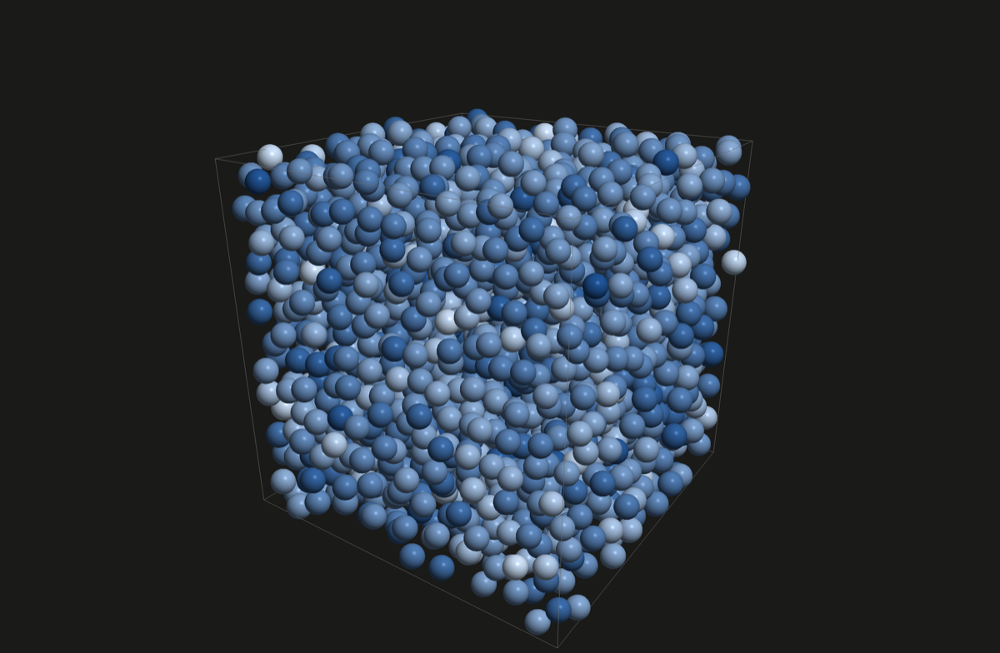

All quantities are in reduced Lennard-Jones units (ε = σ = m = k_B = 1).

## Features

- **Lennard-Jones potential**, truncated at r_c = 2.5σ and shifted so the energy is zero at the cutoff
- **Velocity Verlet** integration (time-reversible, second order)
- **Periodic boundary conditions** with the minimum image convention
- **Cell lists** (counting sort into cells ≥ r_c + skin wide) used to build **Verlet neighbour lists**, rebuilt
  only when some particle has moved more than half the skin
- **OpenMP** parallel force calculation, neighbour list build, integration and reductions
- **Reproducible results:** bitwise-identical runs at a fixed thread count by default, and at *any* thread
  count with `--deterministic`
- **SIMD-vectorised force kernel** (`#pragma omp simd`, confirmed with compiler vectorisation reports), with
  an optional **mixed-precision** mode (float pair maths, double positions and accumulation)
- **Hot/cold memory layout:** positions packed per particle for the neighbour gathers, everything else in
  separate arrays per component, chosen by measuring it against both pure layouts
- **Validated against NIST** reference data for the Lennard-Jones fluid (energy and virial pressure), with
  error bars from independent replicas
- **Bussi stochastic velocity rescaling** thermostat for correct canonical (NVT) sampling
- **Observables:** virial pressure, radial distribution function g(r), and **extended XYZ trajectories** with
  stable particle ids (readable by OVITO, VMD and ASE)
- **Real-time OpenGL visualiser** (`md_vis`): particles drawn as sphere-shaded point sprites coloured by
  speed, with live temperature control to melt or freeze the system
- Particles **re-sorted by cell** on every list rebuild, so spatial neighbours are neighbours in memory
- **FCC lattice** initialisation with Maxwell-Boltzmann velocities, a velocity-rescaling equilibration phase
  (optionally melting at T = 2 first), then NVE or NVT production
- A **benchmark suite** (`bench/benchmark.py`) that runs the sweeps below and regenerates every plot

## How it works

All quantities are in reduced units: lengths in σ, energies in ε, masses in m, temperature in ε/k_B and time
in $t^* = \sigma\sqrt{m/\varepsilon}$.

### 1. The Lennard-Jones potential and force

Two particles at distance $r$ interact through

```math
V(r) = 4\varepsilon\left[\left(\frac{\sigma}{r}\right)^{12} - \left(\frac{\sigma}{r}\right)^{6}\right]
```

The $r^{-12}$ term is short-range repulsion (electron clouds overlapping) and the $r^{-6}$ term is the van der
Waals attraction. The minimum is at $r = 2^{1/6}\sigma \approx 1.12\sigma$, where the force is zero (checked in
the tests).

The force on particle $i$ from particle $j$ is $\mathbf{F}_{ij} = -\nabla_i V$. Writing
$\mathbf{r}_{ij} = \mathbf{r}_i - \mathbf{r}_j$:

```math
\mathbf{F}_{ij} = \frac{F(r)}{r}\,\mathbf{r}_{ij}, \qquad
\frac{F(r)}{r} = \frac{24\varepsilon}{r^2}\left[2\left(\frac{\sigma}{r}\right)^{12} - \left(\frac{\sigma}{r}\right)^{6}\right]
```

**Why the code works with $r^2$:** everything above depends only on even powers of $r$, so the kernel
computes $1/r^2$, then $(\sigma/r)^6 = (\sigma^2/r^2)^3$ and $(\sigma/r)^{12} = \left((\sigma/r)^6\right)^2$,
and never takes a square root. Newton's third law, $\mathbf{F}_{ji} = -\mathbf{F}_{ij}$, means each pair is
computed once and applied to both particles.

### 2. Truncating and shifting the potential

$V(r)$ never reaches zero, but beyond about $2.5\sigma$ it is tiny, so pairs farther apart than a cutoff
$r_c$ are ignored. Cutting it off abruptly would make the energy jump every time a pair crosses $r_c$, so the
potential is also shifted:

```math
V_s(r) = \begin{cases} V(r) - V(r_c) & r < r_c \\ 0 & r \ge r_c \end{cases}
```

The shift is a constant, so it **doesn't change the force**: the dynamics are those of the truncated
potential, and only the reported energy changes. The force still jumps from $F(r_c)$ to zero at the cutoff
($|F(2.5\sigma)| = 0.039$, $|F(3.5\sigma)| = 0.0037$). That jump is what makes the energy error deviate from
$\Delta t^2$ at small timesteps (see Benchmarks).

### 3. Periodic boundary conditions

A real liquid sample has about $10^{23}$ particles; this one has hundreds to thousands. To avoid walls, the
cubic box of side $L$ is surrounded by infinitely many copies of itself, and a particle leaving one face
re-enters through the opposite one. Two operations implement this:

```math
x \leftarrow x - L\left\lfloor \frac{x}{L} \right\rfloor
\qquad\text{(wrap a coordinate into } [0, L)\text{)}
```

```math
\Delta x \leftarrow \Delta x - L\,\mathrm{round}\!\left(\frac{\Delta x}{L}\right)
\qquad\text{(minimum image: the nearest periodic copy)}
```

The minimum image is only correct if each particle interacts with at most one copy of any other, which needs
$r_c < L/2$. The code checks this and throws an error otherwise. It stores $1/L$ so that each pair needs a
multiplication rather than a division.

### 4. Velocity Verlet integration

Newton's equations $m\ddot{\mathbf{r}}_i = \mathbf{F}_i$ are advanced by a timestep $\Delta t$ in three stages:

```math
\begin{aligned}
\mathbf{v}_i\!\left(t + \tfrac{\Delta t}{2}\right) &= \mathbf{v}_i(t) + \frac{\Delta t}{2m_i}\mathbf{F}_i(t) \\
\mathbf{r}_i(t + \Delta t) &= \mathbf{r}_i(t) + \Delta t\,\mathbf{v}_i\!\left(t + \tfrac{\Delta t}{2}\right) \\
\mathbf{v}_i(t + \Delta t) &= \mathbf{v}_i\!\left(t + \tfrac{\Delta t}{2}\right) + \frac{\Delta t}{2m_i}\mathbf{F}_i(t + \Delta t)
\end{aligned}
```

**Why this integrator:**

- **Time-reversible.** Running forward, flipping all velocities and running the same number of steps returns
  every particle to its start. The test suite checks this to within $10^{-8}$.
- **Symplectic.** It exactly conserves a slightly perturbed "shadow" Hamiltonian
  $\tilde{H} = H + O(\Delta t^2)$. So the true energy fluctuates with amplitude $\propto \Delta t^2$ but
  **doesn't drift**, even over millions of steps. A simpler non-symplectic method, such as forward Euler,
  gains energy steadily.
- **Cheap.** One force evaluation per step, the expensive part.

### 5. Cell lists and Verlet neighbour lists

Checking all $N(N-1)/2$ pairs costs $O(N^2)$. But each particle only interacts with the
$\approx \tfrac{4}{3}\pi r_c^3 \rho$ particles within $r_c$, a number independent of $N$.

**Cell list.** The box is divided into cubic cells at least $r_l$ wide, and particles are binned into them
with a counting sort, which is $O(N)$. Every neighbour within $r_l$ is then in the particle's own cell or one
of its 26 neighbours. That examines $27\rho\ell^3 \ge 27\rho r_l^3$ candidates, of which only
$\tfrac{4}{3}\pi\rho r_l^3$ are real neighbours: an efficiency of $4\pi/81 \approx 16\%$.

**Verlet list.** So the cells are used only to *build* a per-particle neighbour list with a slightly larger
radius $r_l = r_c + s$, where $s$ is the skin. That list is reused for many steps and rebuilt only when

```math
\max_i \left|\mathbf{r}_i - \mathbf{r}_i^{\text{build}}\right| > \frac{s}{2}
```

**Why $s/2$ is safe:** a pair missing from the list was more than $r_c + s$ apart at the build. To come within
$r_c$, their separation must shrink by more than $s$. If neither particle has moved more than $s/2$, it can
have shrunk by at most $s$, so no interacting pair is missed. The skin trades rebuild frequency against the
extra pairs carried every step (see the skin sweep).

### 6. Temperature, pressure and energy

**Temperature** comes from equipartition. Each degree of freedom carries $\tfrac{1}{2}k_BT$ of kinetic
energy, and total momentum is conserved, which removes 3 of the $3N$:

```math
K = \sum_i \tfrac{1}{2} m_i v_i^2 = \frac{N_f}{2}k_BT, \qquad N_f = 3N - 3
```

**Pressure** comes from the virial theorem. The kinetic part is the ideal-gas pressure; the virial
$W = \sum_{i<j}\mathbf{r}_{ij}\cdot\mathbf{F}_{ij} = \sum_{i<j} \frac{F(r_{ij})}{r_{ij}} r_{ij}^2$ adds the
effect of the forces:

```math
P = \frac{2K + W}{3V}
```

**Tail corrections.** Comparing with reference data needs the contribution of pairs beyond $r_c$. Assuming the
fluid is uniform there ($g(r) = 1$ for $r > r_c$) and integrating $V(r)$ and $rF(r)$ over that region gives,
per particle:

```math
\frac{U_{\text{tail}}}{N} = \frac{8}{3}\pi\rho\varepsilon\sigma^3\left[\frac{1}{3}\left(\frac{\sigma}{r_c}\right)^9 - \left(\frac{\sigma}{r_c}\right)^3\right],
\qquad
P_{\text{tail}} = \frac{16}{3}\pi\rho^2\varepsilon\sigma^3\left[\frac{2}{3}\left(\frac{\sigma}{r_c}\right)^9 - \left(\frac{\sigma}{r_c}\right)^3\right]
```

The reference data uses the *unshifted* truncated energy. With $n_c$ pairs inside the cutoff, which every force
calculation counts, the conversion is exact:

```math
U_{\text{truncated}} = U_{\text{shifted}} + n_c\,V(r_c)
```

**Radial distribution function.** $g(r)$ compares the number of pairs at distance $r$ with what an ideal gas
at the same density would have. For a histogram bin $[r_1, r_2)$ averaged over $M$ samples:

```math
g(r) = \frac{n_{\text{pairs}}(r_1, r_2)}{M \cdot \tfrac{N}{2} \cdot \rho \cdot \tfrac{4}{3}\pi\left(r_2^3 - r_1^3\right)}
```

The $N/2$ is there because the half neighbour list counts each pair once. An ideal gas gives $g = 1$ at every
$r$, which is a test.

### 7. Initial conditions and thermostats

**Lattice.** Particles start on a face-centred cubic lattice: 4 per cubic unit cell, so $N = 4n^3$ and the
lattice constant is $a = (4/\rho)^{1/3}$. The minimum distance is $a/\sqrt{2}$, which avoids the huge
repulsive forces random placement would create.

**Velocities.** Each component is drawn from the Maxwell-Boltzmann distribution, a Gaussian with variance
$k_BT/m$. The centre-of-mass velocity is then subtracted, so the box doesn't drift, and all velocities are
scaled by $\lambda = \sqrt{T_0/T}$ to hit the target exactly.

**Equilibration thermostat.** The same rescaling, every 10 steps, while the lattice melts. It pins the kinetic
energy, which suppresses its natural fluctuations, so it is only used to reach equilibrium.

**Bussi stochastic velocity rescaling (NVT production).** In the canonical ensemble the kinetic energy
fluctuates, with distribution $P(K) \propto K^{N_f/2 - 1} e^{-K/k_BT}$. Each step, the Bussi thermostat
relaxes $K$ towards its target $\bar{K} = \tfrac{N_f}{2}k_BT$ with time constant $\tau$, plus a random kick
sized so that exactly this distribution is sampled:

```math
K' = K + (1 - c)\left[\frac{\bar{K}}{N_f}\left(R_1^2 + \sum_{i=2}^{N_f} R_i^2\right) - K\right]
+ 2R_1\sqrt{\frac{c(1 - c)\,K\bar{K}}{N_f}}, \qquad c = e^{-\Delta t/\tau}
```

Here the $R_i$ are independent standard Gaussians. The sum of $N_f - 1$ squared Gaussians is drawn directly
as one chi-squared variable. All velocities are then scaled by $\sqrt{K'/K}$. The test suite checks the
result: mean temperature at the target, and $\mathrm{Var}(K) = \tfrac{N_f}{2}(k_BT)^2$.

### 8. Floating point and reproducibility

Floating-point addition is not associative. For example, $(10^{16} + 1) - 10^{16} = 0$ but
$(10^{16} - 10^{16}) + 1 = 1$. An OpenMP `reduction(+)` combines per-thread partial sums in an unspecified
order, so the same input can give results that differ in the last bit.

MD is chaotic: a small difference grows as $\delta(t) \approx \delta_0 e^{\lambda t}$, where $\lambda$ is the
largest Lyapunov exponent. Starting from $\delta_0 \sim 10^{-16}$, two runs become completely different
trajectories within tens of time units. Statistical averages are unaffected, but bit-for-bit
reproducibility is lost. Hence the fixed-order sums (`deterministicSum`), and the deterministic force mode
in which each particle adds its pair forces in an order fixed by the neighbour list.

**Mixed precision.** A float carries about 7 significant digits ($2^{-24} \approx 6\times10^{-8}$ relative).
Positions up to $L \approx 25\sigma$ in float would only be accurate to about $10^{-6}\sigma$. So positions and
the minimum image stay double, and only the separations, which are at most $r_l \approx 2.7\sigma$, are
narrowed to float, for an absolute error of about $10^{-7}\sigma$.

### 9. Statistics: error bars for correlated data

Successive MD samples are correlated, so the naive standard error $s/\sqrt{n}$ is too small. With an
integrated correlation time $\tau_{\text{int}}$, measured in samples:

```math
\mathrm{Var}(\bar{x}) \approx \frac{s^2}{n}\cdot 2\tau_{\text{int}}
```

**Block averaging** splits the run into $M$ blocks longer than the correlation time. Their means are then
independent, so $\mathrm{SE} = s_{\text{blocks}}/\sqrt{M}$. This is only trustworthy if the estimate levels
off as the blocks grow. Here it didn't (see the blocking plot), so the validation uses **independent
replicas** instead: $R$ runs with different seeds, with $\mathrm{SE} = s_R/\sqrt{R}$.

Each comparison with reference data is a z-score, and the overall agreement is a χ² sum:

```math
z = \frac{x - x_{\text{ref}}}{\sqrt{\sigma_x^2 + \sigma_{\text{ref}}^2}}, \qquad \chi^2 = \sum_k z_k^2
```

If the only differences are statistical, each $z \sim \mathcal{N}(0, 1)$, and $\chi^2$ over 20 comparisons has
mean 20 and standard deviation $\sqrt{40} \approx 6.3$. The measured value is 17.2.

**Energy error scaling.** Following §4, the relative energy fluctuation should scale as
$\Delta t^2$: a straight line of slope 2 on log-log axes. The timestep benchmark measures that slope.

## Build and run

Requires CMake ≥ 3.16 and a C++20 compiler. 
OpenMP is optional (the build falls back to a single thread).
On macOS, Apple Clang needs `brew install libomp`.

```bash
cmake -S . -B build/release -DCMAKE_BUILD_TYPE=Release
cmake --build build/release
./build/release/md_sim # 500 particles: 2000 equilibration + 5000 production steps
```

```
md_sim [cellsPerSide] [--brute] [--dt X] [--skin X] [--cutoff X] [--equil N] [--steps N] [--density X]
       [--temperature X] [--nvt] [--seed N] [--melt] [--csv PATH] [--rdf PATH] [--xyz PATH] [--xyz-every N]
       [--deterministic] [--mixed] [--quiet]
```

| Option | Default | Meaning |
|---|---|---|
| `cellsPerSide` | 5 | FCC unit cells per side: N = 4 × cellsPerSide³ |
| `--brute` | off | O(N²) all-pairs forces instead of the neighbour list |
| `--dt` | 0.005 | timestep |
| `--skin` | 0.2 | neighbour list skin |
| `--cutoff` | 2.5 | interaction cutoff |
| `--equil` / `--steps` | 2000 / 5000 | equilibration / production steps |
| `--density` / `--temperature` | 0.8442 / 0.728 | state point |
| `--nvt` | off | keep the Bussi thermostat on during production (default production is NVE) |
| `--melt` | off | spend the first third of equilibration at T = 2, so dense states start from a liquid |
| `--seed` | 42 | initial velocities and thermostat noise |
| `--csv` | – | write per-step energies, temperature, pressure and pairs inside the cutoff |
| `--rdf` | – | write g(r) averaged over production |
| `--xyz` / `--xyz-every` | – / 100 | write an extended XYZ trajectory every N production steps |
| `--deterministic` | off | bitwise-identical results for any thread count (costs 6–36%) |
| `--mixed` | off | float pair maths (4 SIMD lanes), double positions and accumulation |
| `--quiet` | off | print only the machine-readable `RESULT` line |

Set the thread count with `OMP_NUM_THREADS`.

### Visualiser

`md_vis` is built when GLFW is installed (`brew install glfw`, or `libglfw3-dev` on Linux). It needs
OpenGL 4.1 and has only been tested on macOS.

```bash
./build/release/md_vis 8          # 4 × 8³ = 2048 particles
```

| Input | Action |
|---|---|
| drag / scroll | orbit / zoom |
| Space | pause |
| ↑ / ↓ | more / fewer steps per frame |
| H / C | heat / cool by 10% (sets the thermostat target) |
| T | thermostat on / off |
| R | reset to the lattice |

Temperature, energy and frame rate are shown in the window title. `--screenshot out.ppm [--frames N]`
renders N frames off-screen, saves the last one and exits.

## Testing

```bash
ctest --test-dir build/release --output-on-failure     # 37 GoogleTest tests, ~5 s
```

The tests cover every component:

- **Forces against analytic values:** two-particle force and energy, the zero-force point at 2^(1/6)σ,
  nothing beyond the cutoff, interaction across a periodic boundary.
- **Neighbour-list forces against the O(N²) reference**, at 1, 3 and 8 threads (3 checks uneven work
  division); total force ≈ 0.
- **Neighbour list** contains exactly the pairs within r_c + skin, including the small-box fallback, and
  rebuilds only after a particle moves more than half the skin.
- **Cell list:** each particle is in exactly one cell, matching its position; the 27 neighbour cells are
  distinct and wrap around the box.
- **Dynamics:** energy conservation, momentum conservation, and **time reversibility** (run forward, flip
  velocities, run back, and every particle returns to within 10⁻⁸ of its start).
- **Determinism:** identical state hashes across repeated runs at a fixed thread count, and across 1–8
  threads in deterministic mode.
- **Observables:** the virial and pair counts agree across all force paths; the Bussi thermostat alone
  reproduces the canonical mean and variance of the kinetic energy; g(r) of an ideal gas is 1.
- **Mixed precision** matches the double-precision forces to float accuracy and still conserves energy.
- **Trajectories:** particle ids survive re-sorting, and line k of every XYZ frame is the same particle.

The tests were checked by deliberately breaking the code: skipping neighbour cells, or flipping the sign of
the SIMD scatter, makes 6 and 7 tests fail respectively.

CI (GitHub Actions) builds and tests on Linux and macOS with warnings as errors (`-DMD_WERROR=ON`), runs the
tests under AddressSanitizer + UndefinedBehaviorSanitizer and under ThreadSanitizer (with LLVM's Archer, so
OpenMP's own synchronisation is understood), and checks formatting (`clang-format`, pinned to 23.1.3) and
static analysis (`clang-tidy`: bug-prone patterns, performance and the clang static analyser). For a sanitizer
build locally: `-DMD_SANITIZE=address,undefined` or `-DMD_SANITIZE=thread`.

clang-tidy found two real bugs when it was added: `atoi`/`atof` turned bad arguments such as `--steps 12abc`
into 0 without complaint (now rejected), and a pixel offset in the screenshot code was computed in `int`
before widening, which overflows for large images.

## Validation against NIST

The engine is checked against the NIST Standard Reference Simulation Website's Lennard-Jones benchmarks
([NVT Monte Carlo](https://mmlapps.nist.gov/srs/LJ_PURE/mc.htm), N = 500, cutoff 3σ, standard long-range
corrections, virial pressure). Run it with `python bench/validate.py` (about 25 minutes).

Each state point is 8 independent NVT runs (Bussi thermostat; 50 t* equilibration starting from a lattice
melted at T = 2, then 100 t* production). Energies are converted to NIST's convention: the shift is removed
using the number of pairs inside the cutoff, and the standard tail corrections are added.

| T | ρ | U (this engine) | U (NIST) | z | P (this engine) | P (NIST) | z |
|---|---|---|---|---|---|---|---|
| 0.85 | 0.776 | −5.5120 ± 0.0009 | −5.5121 ± 0.0005 | 0.1 | −0.0002 ± 0.0048 | 0.0068 ± 0.0018 | −1.4 |
| 0.85 | 0.780 | −5.5382 ± 0.0013 | −5.5386 ± 0.0007 | 0.2 | 0.0413 ± 0.0076 | 0.0479 ± 0.0032 | −0.8 |
| 0.85 | 0.820 | −5.7921 ± 0.0013 | −5.7947 ± 0.0006 | 1.8 | 0.5588 ± 0.0074 | 0.5535 ± 0.0041 | 0.6 |
| 0.85 | 0.860 | −6.0276 ± 0.0011 | −6.0305 ± 0.0024 | 1.1 | 1.2768 ± 0.0060 | 1.2660 ± 0.0136 | 0.7 |
| 0.85 | 0.900 | −6.2355 ± 0.0015 | −6.2391 ± 0.0053 | 0.7 | 2.2427 ± 0.0083 | 2.2314 ± 0.0272 | 0.4 |
| 0.90 | 0.776 | −5.4671 ± 0.0015 | −5.4689 ± 0.0004 | 1.2 | 0.2412 ± 0.0076 | 0.2406 ± 0.0027 | 0.1 |
| 0.90 | 0.780 | −5.4950 ± 0.0013 | −5.4956 ± 0.0008 | 0.4 | 0.2756 ± 0.0078 | 0.2785 ± 0.0030 | −0.4 |
| 0.90 | 0.820 | −5.7453 ± 0.0009 | −5.7456 ± 0.0008 | 0.3 | 0.8186 ± 0.0042 | 0.8239 ± 0.0029 | −1.0 |
| 0.90 | 0.860 | −5.9742 ± 0.0011 | −5.9753 ± 0.0006 | 0.9 | 1.5762 ± 0.0062 | 1.5781 ± 0.0033 | −0.3 |
| 0.90 | 0.900 | −6.1733 ± 0.0015 | −6.1773 ± 0.0016 | 1.9 | 2.5995 ± 0.0087 | 2.5848 ± 0.0095 | 1.1 |

z = (this engine − NIST) / combined standard error. All 20 comparisons have |z| < 2, and χ² = 17.2 for 20
comparisons, which is what purely statistical differences produce.

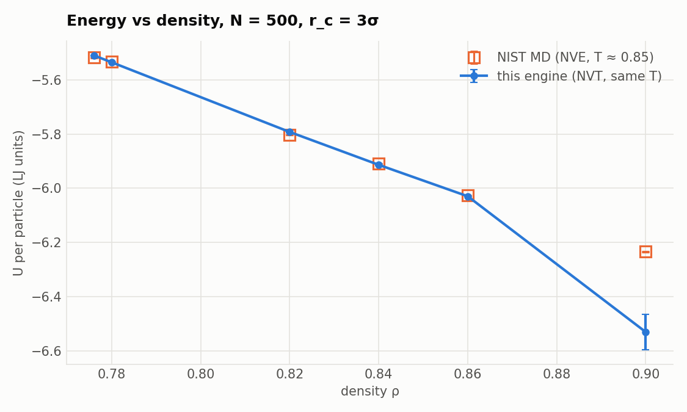
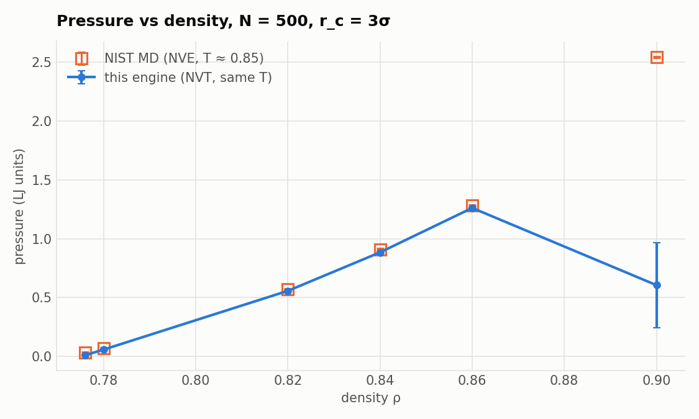
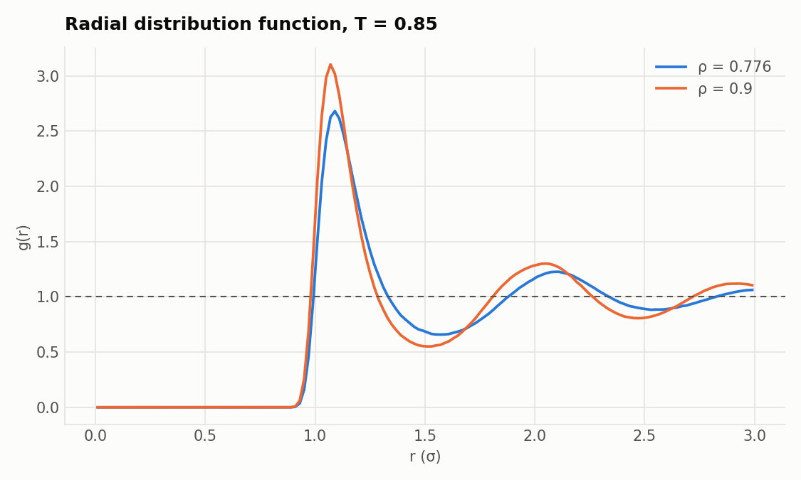

**Getting the error bars right took three attempts**, and the first two were wrong in instructive ways:

1. With one run per state point and errors from block averaging, every point came out slightly *above* NIST
   (z ≈ 2–3 throughout). Two hypotheses for a real bias were tested and ruled out: the timestep (results
   unchanged from dt = 0.005 to 0.00125) and the potential shift changing which configurations are sampled
   (reweighting the samples to the unshifted potential moved U by at most 0.0015).
2. The cause was statistical. The blocking curve never reaches a plateau, so block averaging underestimated
   the error; the spread of independent replicas is 30–40% larger. And every state point had used the same
   seed, so they shared thermostat noise and their errors were correlated, which made them all lean the same
   way. Independent replicas with distinct seeds removed the "bias".
3. Then at ρ = 0.90 some replicas froze: they started from an FCC lattice near the freezing line and never
   melted. Melting at T = 2 before cooling to the target fixed it.

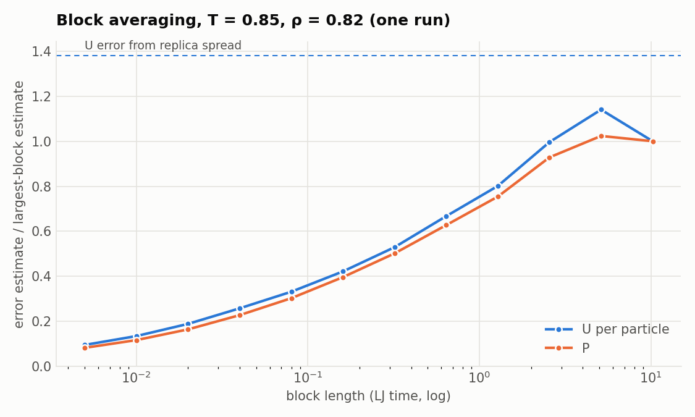

NIST also publishes NVE molecular dynamics data at T ≈ 0.85. Those values differ from NIST's own Monte Carlo
data by more than their quoted error bars at several points (most clearly the pressure at ρ = 0.90: 2.544 from
MD, 2.231 from MC). This engine's results agree with the Monte Carlo data.

## Benchmarks

Measured on an Apple M1 MacBook Air (4 performance + 4 efficiency cores, fanless). Timings are the fastest of 3 runs. To regenerate everything (results go to `bench/results/`, plots to `bench/plots/`):

```bash
python bench/benchmark.py            # full suite, a few minutes
python bench/benchmark.py --quick    # smoke test, seconds
```

### Neighbour lists: O(N²) → O(N)

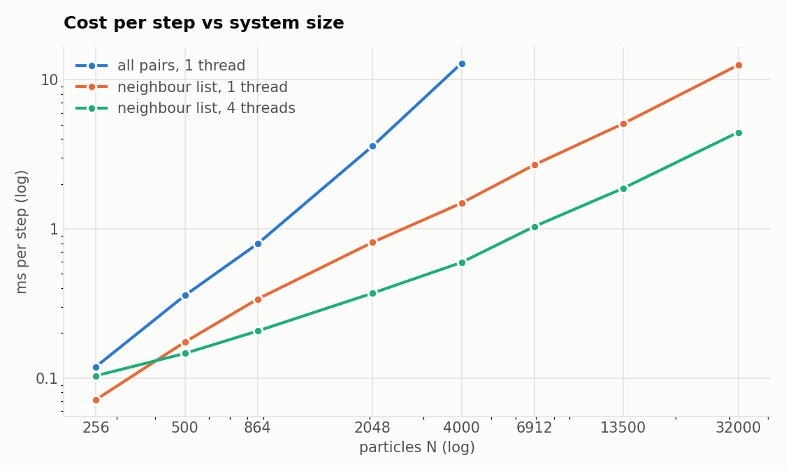

| N = 4000 | ms / step | vs all pairs |
|---|---|---|
| All pairs, 1 thread | 12.7 | 1× |
| Neighbour list, 1 thread | 1.44 | **8.8×** |
| Neighbour list, 4 threads | 0.58 | **21.7×** |

From 256 to 32,000 particles, the neighbour-list cost grows as about N^1.08.

### OpenMP scaling

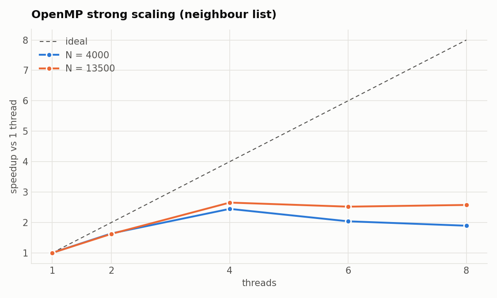

The speedup at 4 threads is 2.4× for N = 4000 and 2.7× for N = 13,500. It levels off beyond 4 threads, as
expected on the M1: `schedule(static)` gives every thread an equal share, so once the slower efficiency cores
join, the other threads wait for them.

### Energy conservation

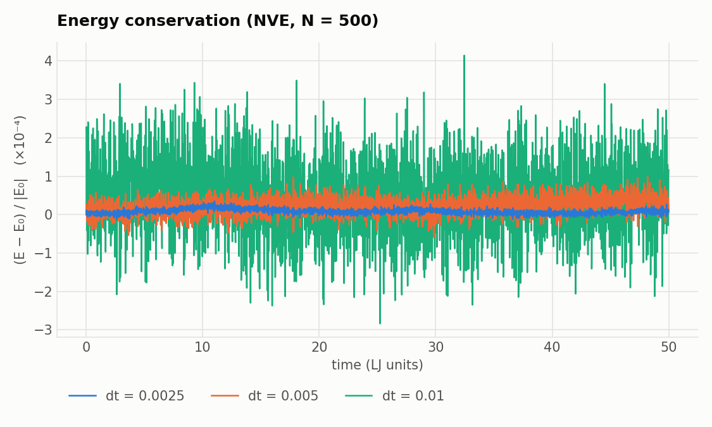

With the thermostat off, total energy stays within about 10⁻⁴ of its starting value, with no long-term drift.

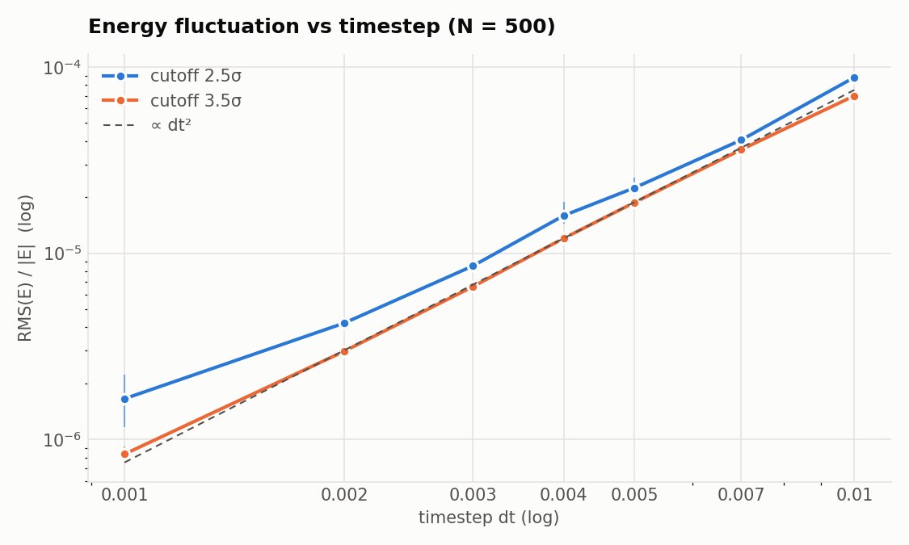

Velocity Verlet is second order, so the energy error should scale as dt². With a 3.5σ cutoff it does
(measured slope 1.92). With 2.5σ the slope is 1.73 and the curve flattens at small dt: the force drops
abruptly to zero at the cutoff, and every pair that crosses it adds error that doesn't shrink with dt. Raising
the cutoff makes that jump about 10× smaller (0.039 → 0.0037), and the excess error disappears. Each point is the mean of 3
runs with different seeds, with whiskers showing the spread.

### Temperature stability

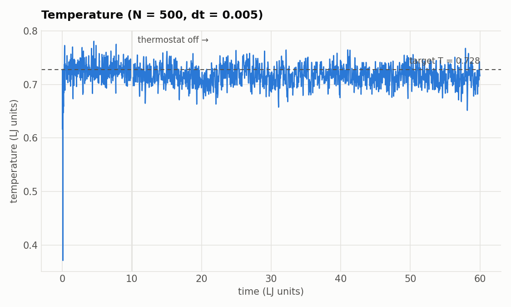

During equilibration, velocities are rescaled to the target temperature every 10 steps. The early dip is the
FCC lattice melting: kinetic energy turns into potential energy faster than the rescaling can correct. After
the thermostat is switched off, the temperature fluctuates around the target as expected for a closed system.

### Neighbour list skin

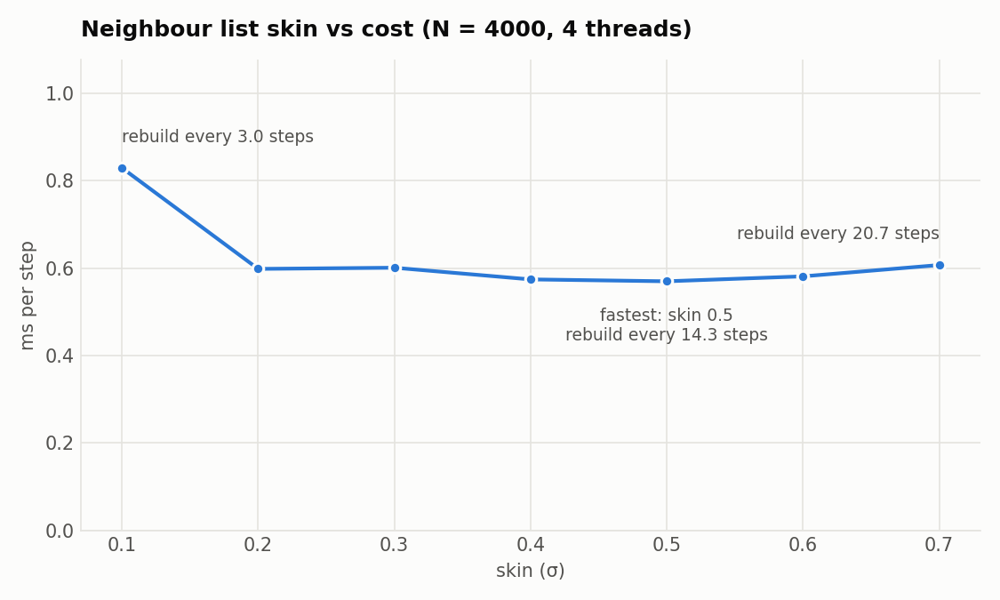

A small skin means frequent rebuilds; a large skin means more pairs to check every step. 0.1σ is clearly too
small (rebuilds every 3 steps). From 0.2σ to 0.6σ the cost is flat to within about 5%, which is the size of
run-to-run noise on this machine. An earlier run, before the kernel and layout changes, had 0.2σ ahead by
12%; it remains the default.

## Design notes

**Parallel forces without races.** The force loop visits each pair once (a half neighbour list) and applies
equal and opposite forces to both particles. Two threads can share a particle `j`, so each thread adds forces
into its own array, and a second parallel loop sums the arrays for each particle.

My first version used a *full* neighbour list instead: every pair stored twice, so each thread writes only
its own particle and needs no extra arrays. Profiling and timing showed that this doubled the force work and roughly quadrupled the
list-build work (both directions, each searched twice). It was about 2.4× slower than the serial code on one thread.
Switching to a half list with per-thread arrays made a single thread 1.3× faster than the original serial
code. Full lists remain the better fit for GPUs, where thousands of threads would need thousands of force
arrays.

**Parallel list build.** Each thread finds the neighbours of its own contiguous block of particles and
appends them to a private buffer. A prefix sum over the per-particle counts gives the compact (CSR) offsets,
and the buffers are concatenated in thread order.

**SIMD force kernel.** The compiler would not vectorise the original pair loop: its cost model judged the
`if (r2 >= rc²) continue` branch and the scattered writes to `forces[j]` too expensive. The kernel now
handles each particle in three stages:

1. **gather** the neighbours' positions into contiguous per-component arrays (scalar loads; ARM NEON has no
   gather instruction);
2. **compute** minimum image, r², the LJ terms and the cutoff mask in a branch-free `#pragma omp simd` loop.
   Pairs beyond the cutoff (still in the list because of the skin) are computed and masked to zero;
3. **scatter** the equal and opposite forces back to each `j` (scalar stores).

Clang's `-Rpass=loop-vectorize` confirms that the compute loop is vectorised at width 2, the full NEON
width for doubles. Measured at N = 4000 on one thread, from builds of identical source with SIMD on and off:

| Kernel | ms / step | |
|---|---|---|
| Original scalar loop | 1.83 | |
| Gather / compute / scatter, vectorisation off | 1.68 | 1.09× (branch-free, contiguous) |
| Gather / compute / scatter, SIMD on | 1.46 | 1.15× from SIMD, **1.25× total** |

This is far below the 2× ideal: NEON holds only 2 doubles, the gather and scatter stay scalar, and list
rebuilds and integration aren't vectorised.

**Memory layout.** Three layouts were measured on the same code: one struct per particle (array of structs),
one array per component (struct of arrays), and a hot/cold split (positions packed as `x y z pad`, everything
else one array per component). All three produce bit-identical trajectories, checked with the state hash.
Timings are medians over runs that rotate the order of the binaries, because on a fanless laptop whichever
runs first is faster; an unrotated comparison had made the hybrid look 9% slower.

| | N = 4000, 1 thread | N = 4000, 4 threads | N = 32,000, 4 threads |
|---|---|---|---|
| Array of structs | 1.000× | 1.000× | 1.000× |
| Struct of arrays | 0.967× | 0.967× | 0.941× |
| **Hot/cold split** (used) | **1.012×** | **1.016×** | **1.008×** |

The hot loop is a gather: for each neighbour j it loads x[j], y[j], z[j]. Pure struct of arrays turns that
into 3 cache lines per neighbour instead of 1, so it is slower even though the integrator now vectorises.
Packing just the positions keeps the gather to one 32-byte load per neighbour. The effect is small either way:
the step is mostly compute-bound and a 32,000-particle system fits in the M1's caches.

**Mixed precision.** With `--mixed`, positions, the minimum image and all sums across particles stay double,
and the separations are narrowed to float for the pair maths. Separations are at most the list radius, so
float keeps about 7 significant digits of each. The compute loop then vectorises at width 4 instead of 2:

| | double | mixed | max energy drift (double / mixed) |
|---|---|---|---|
| N = 4000, 1 thread | 1.445 ms | 1.320 ms (1.09×) | 4.5×10⁻⁵ / 4.1×10⁻⁵ |
| N = 4000, 4 threads | 0.588 ms | 0.544 ms (1.08×) | 3.2×10⁻⁵ / 4.1×10⁻⁵ |
| N = 32,000, 4 threads | 4.892 ms | 4.494 ms (1.09×) | 1.5×10⁻⁵ / 1.9×10⁻⁵ |

Energy conservation is unchanged. The step gains only 9% because the compute loop is no longer the whole
cost: the scalar gather and scatter and the list rebuilds take the same time in both modes.

**Reproducibility.** Every run prints a hash of the final positions and velocities (`state_hash` in the
`RESULT` line), so two runs can be compared bit for bit. At first, 6 runs at 4 threads gave 4 different final
states. The cause was `reduction(+)` in the kinetic energy: OpenMP combines the per-thread partial sums in
an unspecified order, so the last bits can differ, and the thermostat feeds that value back into the
trajectory. MD is chaotic, so a last-bit difference grows into a completely different trajectory. Two fixes,
at two strengths:

- **Default: identical at a fixed thread count.** Energies use a fixed-order blocked sum
  (`deterministicSum`: fixed-size blocks summed in parallel, then combined in order). The force arrays were
  already summed in thread order. No measurable cost.
- **`--deterministic`: identical at any thread count.** The per-thread force arrays group each particle's
  contributions differently depending on the thread count. So in this mode every pair's force goes to its
  own slot, and each particle then adds up its own contributions in an order fixed by the neighbour list
  (pairs where it is first, then a reverse index of pairs where it is second). The extra memory traffic
  costs:

| | default | `--deterministic` | |
|---|---|---|---|
| N = 4000, 1 thread | 1.44 ms | 1.68 ms | +17% |
| N = 4000, 4 threads | 0.70 ms | 0.74 ms | +6% |
| N = 13,500, 1 thread | 5.30 ms | 6.17 ms | +16% |
| N = 13,500, 4 threads | 1.92 ms | 2.61 ms | +36% |

The worst case is large N on 4 threads: the per-pair arrays (~13 MB) no longer fit in cache, and the
reverse-index pass reads them from scattered addresses. Restoring the old reduction makes the reproducibility test fail in 3 of 5
runs.

**Checking correctness.** The neighbour-list forces match the O(N²) reference to within 2×10⁻¹⁴, at several
thread counts including uneven ones. Energy conservation acts as an end-to-end check: a race or a missed pair
shows up as drift.

## Project layout

```
include/, src/
  Particle        plain particle record for setup and I/O
  System          particle storage (hot/cold layout), stable ids, box, periodic boundaries, kinetic energy
  Forcefield      Lennard-Jones forces: O(N²) reference, parallel SIMD, deterministic and mixed-precision
                  neighbour-list versions; virial and pair counts
  CellList        particles binned into cells for neighbour search
  NeighbourList   Verlet list: parallel build, displacement-based rebuild
  Integrator      Velocity Verlet
  Initialisation  FCC lattice, Maxwell-Boltzmann velocities
  Thermostat      velocity rescaling (equilibration) and Bussi stochastic rescaling (NVT)
  RadialDistribution  g(r) from neighbour-list pairs
  Trajectory      extended XYZ output in particle-id order
  CommandLine.hpp checked number parsing for the command-line drivers
  Parallel.hpp    OpenMP thread helpers with single-thread fallbacks
  main.cpp        command-line driver
vis/
  Renderer        OpenGL drawing: point-sprite spheres, box outline, orbit camera
  main.cpp        md_vis window, input and live simulation loop
tests/              GoogleTest unit tests
bench/benchmark.py  benchmark runner and plots
bench/validate.py   validation against NIST reference data
.github/workflows/  CI: Linux + macOS build and test (-Werror), ASan/UBSan and TSan, clang-format and clang-tidy
```


## References

**Methods**

- L. Verlet, "Computer 'experiments' on classical fluids. I. Thermodynamical properties of Lennard-Jones
  molecules", *Phys. Rev.* **159**, 98 (1967). The neighbour list with a skin, and the Verlet integrator.
- W. C. Swope, H. C. Andersen, P. H. Berens and K. R. Wilson, *J. Chem. Phys.* **76**, 637 (1982). The
  velocity form of the Verlet integrator.
- M. P. Allen and D. J. Tildesley, *Computer Simulation of Liquids*, 2nd ed., Oxford University Press (2017).
  Periodic boundaries and the minimum image convention, cell lists, the truncated-and-shifted potential,
  long-range (tail) corrections for energy and pressure, the virial pressure, and g(r).
- D. Frenkel and B. Smit, *Understanding Molecular Simulation*, 2nd ed., Academic Press (2002). Reduced
  Lennard-Jones units and the standard liquid state point (ρ = 0.8442, T = 0.728).
- G. Bussi, D. Donadio and M. Parrinello, "Canonical sampling through velocity rescaling", *J. Chem. Phys.*
  **126**, 014101 (2007). The stochastic velocity-rescaling thermostat (equation A7 of the paper).
- H. Flyvbjerg and H. G. Petersen, "Error estimates on averages of correlated data", *J. Chem. Phys.* **91**,
  461 (1989). Block averaging, and why it needs a plateau to be trusted.
- S. Páll and B. Hess, "A flexible algorithm for calculating pair interactions on SIMD architectures",
  *Comput. Phys. Commun.* **184**, 2641 (2013). Background for the SIMD kernel, packed positions and mixed
  precision, as used in GROMACS.

**Reference data**

- NIST Standard Reference Simulation Website, Lennard-Jones fluid benchmarks:
  [index](https://mmlapps.nist.gov/srs/LJ_PURE/index.htm),
  [NVT Monte Carlo](https://mmlapps.nist.gov/srs/LJ_PURE/mc.htm) (used for the validation table) and
  [NVE molecular dynamics](https://mmlapps.nist.gov/srs/LJ_PURE/md.htm).

**Tools and formats**

- [OpenMP API specifications](https://www.openmp.org/specifications/): `parallel for`, `simd`, reductions,
  and the unspecified order in which reductions combine partial results.
- [Archer](https://github.com/llvm/llvm-project/tree/main/openmp/tools/archer): LLVM's OpenMP data race
  detection tool, which lets ThreadSanitizer understand OpenMP synchronisation in CI.
- [clang-format style options](https://clang.llvm.org/docs/ClangFormatStyleOptions.html) (including
  `IndentPPDirectives: Leave`) and the [clang-tidy check list](https://clang.llvm.org/extra/clang-tidy/checks/list.html).
- [GoogleTest](https://github.com/google/googletest): unit test framework.
- [Extended XYZ](https://github.com/libAtoms/extxyz): trajectory file format.
